# MEA-Reviewer-Architecture

An enterprise clinical informatics and medical coding adjudication interface engineered to evaluate Large Language Model (LLM) ICD-10-CM and ICD-10-PCS coding pipelines against certified human medical coders. Built as a zero-server, single-file HTML5/JavaScript application operating directly over HIPAA-compliant Enterprise OneDrive partitions.

---

## Executive Summary & Problem Statement

Hospital revenue cycle and clinical natural language processing (NLP) teams routinely benchmark automated medical coding models against human Health Information Management (HIM) specialists. Prior to this workspace, multi-reviewer adjudication relied on shared Microsoft Excel workbooks stored on network drives, introducing three systemic failure modes:

1. **Concurrent Overwrite & File Corruption:** Simultaneous edits by physician reviewers and coding auditors frequently triggered OneDrive/SharePoint merge conflicts, silent cell overwrites, and workbook corruption on cohorts exceeding 10,000 encounter rows.
2. **High Context-Switching Latency:** Reviewers had to alt-tab across three disconnected surfaces: a wide spreadsheet of raw ICD-10 codes, an external Electronic Health Record (EHR) viewer for discharge summaries and operative reports, and browser tabs for official ICD-10-CM/PCS tabular lookups.
3. **Unstructured Error Taxonomies:** Free-text comments inside spreadsheet cells prevented systematic root-cause attribution (such as distinguishing LLM family-history hallucinations from human coder underspecification or MS-DRG-shifting ventilation duration errors).

### Operational Outcomes
- **100% Elimination of Concurrency Collisions:** Deterministic Python pre-sharding isolates each reviewer's queue into an immutable per-user partition (`adjudication_shard_<reviewer_id>.json`).
- **Unified Single-DOM Ergonomics:** Consolidates the side-by-side AI vs. Human adjudication matrix, multi-tab EHR clinical chart viewer with one-click evidence citation, and an embedded ICD-10-CM/PCS billable code dictionary into a single resizable split-pane interface.
- **Structured Closed-Loop Telemetry:** Enforces a standardized five-category clinical coding error taxonomy that exports directly to JSON and CSV for downstream RAG prompt refinement and coder quality assurance benchmarks.

---

## System Architecture

The production workflow separates heavy data engineering and clinical entity alignment (executed offline in Python) from the zero-server client workspace distributed via Enterprise OneDrive.

```mermaid
flowchart TB
    %% Styling Definitions
    classDef source fill:#F3EFE6,stroke:#8C7A6B,stroke-width:1.5px,color:#1C1917
    classDef engine fill:#EFECE6,stroke:#4A3F35,stroke-width:2px,color:#1C1917
    classDef storage fill:#EBF3EE,stroke:#2E6F40,stroke-width:2px,color:#1C1917
    classDef client fill:#FAF8F5,stroke:#1C1917,stroke-width:2px,color:#1C1917
    classDef output fill:#F3EFE6,stroke:#4A3F35,stroke-width:1.5px,color:#1C1917

    %% 1. Data Ingestion Layer
    subgraph L1 ["1. MULTI-SOURCE CLINICAL DATA INGESTION (RCM / EHR)"]
        direction LR
        A1[("Patient EHR Documentation\n• Discharge Summaries & ICU Notes\n• Operative, Cath Lab & Radiology Reports")]:::source
        A2[("AI Medical Coding Output\n• AI-generated ICD-10-CM Diagnoses\n• AI-generated ICD-10-PCS Procedures")]:::source
        A3[("Human Production Coders\n• Baseline human-abstracted code sets\n• Historical ground-truth benchmark")]:::source
    end

    %% 2. Python Automation & Pre-Processing Engine
    subgraph L2 ["2. PYTHON AUTOMATION, CODE ALIGNMENT & SHARDING ENGINE"]
        direction TB
        B1["1. Algorithmic Code-Pair Alignment\n• Pairs matching or sibling AI & Human ICD-10 codes into unified comparison rows\n• Flags unaligned discrepancies (AI-Only vs. Human-Only misses)"]:::engine
        B2["2. Deterministic Reviewer Queue Sharding\n• Partitions dataset by reviewer_username to eliminate Excel concurrency locks\n• Injects patient EHR text directly into isolated user state payloads"]:::engine
        B1 --> B2
    end

    %% 3. HIPAA Boundary & Zero-Server Sync Layer
    subgraph L3 ["3. ENTERPRISE ONEDRIVE HIPAA BOUNDARY (Serverless Storage Layer)"]
        direction LR
        C1[("Isolated Reviewer Shards\n• queue_{username}.json\n• Zero cross-user overwrite risk")]:::storage
        C2[("Embedded ICD-10 Index\n• icd10_cm_pcs_dict.json\n• Local billable & sibling hierarchy")]:::storage
        C3[("Single-File App Bundle\n• adjudication_viewer.html\n• Runs natively in local browser")]:::storage
    end

    %% 4. Client-Side Adjudication Workspace
    subgraph L4 ["4. CLIENT-SIDE HTML/JS ADJUDICATION WORKSPACE (Reviewer DOM)"]
        direction TB
        D1["Local Authentication & Queue Mount\n• Validates Reviewer Username & mounts assigned patient shard with zero network latency"]:::client
        
        subgraph UI ["Unified Split-Pane Clinical Review Interface"]
            direction LR
            D2["Left Pane: Aligned Adjudication Matrix\n• 1-Click Verdicts: Both Correct, Both Wrong, AI Only, Human Only\n• Conditional Error Taxonomy Drawer:\n  - Code Should Not Exist (False Positive)\n  - Overspecified vs. Underspecified\n  - Weak Documentation vs. Wrong Sibling\n• Free-text Replacement ICD-10 Code + Rationale"]:::client
            D3["Right Pane: Embedded EHR Chart Viewer\n• Draggable Split-Screen Resizer\n• Multi-Tab Clinical Notes (Discharge, ICU, Operative, Labs)\n• Zero Context Switching (No external EMR/Excel toggling)"]:::client
            D4["Utility: ICD-10-CM/PCS Lookup\n• Slide-over search drawer without leaving patient view\n• Sibling inspection for laterality & specificity rules"]:::client
        end
        
        D1 --> UI
    end

    %% 5. Output & Error Analysis Layer
    subgraph L5 ["5. ADJUDICATION RESULTS EXPORT & QUANTITATIVE ERROR ANALYSIS"]
        direction LR
        E1[("Structured Reviewer Judgements (CSV / JSON)\n• Exports adjudicated patient rows with side-by-side AI vs. Human verdicts\n• Includes assigned error categories & corrected replacement ICD-10 codes")]:::output
        E2["Downstream Error Analysis & Reporting\n• Aggregates clean reviewer exports without spreadsheet merge conflicts\n• Enables direct statistical evaluation of AI vs. Human coding accuracy & error distribution"]:::output
        E1 --> E2
    end

    %% Connections Across Layers
    A1 & A2 & A3 == "Raw Dataset Ingestion" ==> B1
    B2 == "Automated Background Sync\n(Zero External Web Servers)" ==> L3
    L3 == "Local File Mount via Username Auth\n(Zero Network Latency)" ==> D1
    UI == "1-Click Client-Side Export (.json / .csv)" ==> E1
```

---

## Security & HIPAA Compliance Model

- **Zero External Server Transmission:** The application executes entirely within the local browser runtime (`file://` or internal static host). No Protected Health Information (PHI), patient identifiers, or adjudication verdicts are transmitted to external APIs or third-party cloud telemetry endpoints.
- **Partition-Level Concurrency Isolation:** Rather than relying on a centralized database or shared spreadsheet lock, the upstream Python pipeline partitions encounters by `reviewer_id`. When a reviewer signs in (`admin` or `dr_nader`), only their assigned shard is mounted and persisted to isolated local state.
- **Explicit PHI Compliance Gate:** Every session begins at a formal HIPAA compliance notice requiring reviewer identification prior to mounting clinical narratives.

---

## Core Functional Capabilities

### 1. Authentication & Partition Mounting
- Enforces a formal Protected Health Information (PHI) compliance banner before any clinical dataset is rendered.
- Supports role-based reviewer partitions out of the box:
  - `admin` — Mounts the full three-patient complex inpatient adjudication queue (`adjudication_shard_admin.json`).
  - `dr_nader` — Mounts the two-patient physician reviewer queue (`adjudication_shard_dr_nader.json`).

### 2. Smart AI vs. Human Code Alignment Matrix
- Separates codes into **ICD-10-CM (Diagnoses)** and **ICD-10-PCS (Inpatient Procedures)**.
- **Aligned Rows (Exact or Same-Entity Sibling Match):** Displays AI and Human outputs side-by-side in a unified card with four single-click verdicts: `[Both Correct]`, `[Both Incorrect]`, `[AI Only Correct]`, and `[Human Only Correct]`.
- **Unaligned Rows (`AI Only` or `Human Only`):** Clearly flags omitted counterparts as `— Not Coded —` with contextual verdicts: `[Valid Code (Counterpart Missed)]` and `[Invalid Code (Hallucination / Overcoded)]`.
- **Real-Time Telemetry Footer:** Continuously computes `AI Precision`, `Human Accuracy`, `Baseline Agreement`, and adjudication progress across the active patient encounter.

### 3. Conditional Inline Error Analysis Drawer
Whenever a code row is judged as containing an error or discrepancy, an inline resolution drawer expands beneath the row to capture:
1. **Failure Target:** `AI Error`, `Human Error`, or `Both`.
2. **Standardized Error Category:**
   - `Code Should Not Exist (False Positive)`
   - `Overspecified`
   - `Underspecified`
   - `Weak / Insufficient Documentation`
   - `Wrong Sibling / Laterality / Episode`
3. **Replacement Code & Clinical Rationale:** Monospace ICD-10-CM/PCS input with live description validation and free-text clinical guideline justification.

### 4. Resizable Multi-Tab Clinical Chart Viewer
- Draggable split-pane divider with one-click **Collapse** and **Maximize** controls for dense chart review.
- Displays structured patient demographics (`MRN`, `Age/Sex`, `Admission/Discharge`, `LOS`, Attending Physician, and `MS-DRG`).
- Organizes clinical documentation into four sub-tabs: `Discharge Summary`, `ICU Progress Note`, `Operative / Cath Lab Report`, and `Labs & Radiology`.
- **Direct Evidence Citation:** Clicking `Cite: <Note>` on any coding row automatically switches to the relevant EHR tab, highlights the exact supporting clinical passage, and scrolls it into view.

### 5. Integrated ICD-10-CM & ICD-10-PCS Lookup Drawer
- Accessible via the top navigation bar or `Ctrl+K` keyboard shortcut without losing adjudication context.
- Pre-indexed with 37 clinically relevant ICD-10-CM and ICD-10-PCS codes, complete with official billable descriptions, chapter classifications, `Includes` / `Excludes1` / `Excludes2` / `Code First` instructional notes, one-click clipboard copy, and direct replacement code assignment.

---

## Pre-Loaded Clinical Validation Dataset

The prototype embeds three clinically authentic inpatient cases designed to exercise every error taxonomy pathway:

| Patient ID | Demographics & Clinical Scenario | Highlighted Coding Discrepancies & Audit Scenarios |
| :--- | :--- | :--- |
| **`PT-10492`** | 68M — Septic Shock & Acute Hypoxic Respiratory Failure (`MS-DRG 871`) | **Aligned Match:** `A41.9` & `R65.21` (Sepsis with septic shock). **Sibling Discrepancy:** AI `J96.01` (with hypoxia, supported by SpO2 84% and PaO2 54 mmHg) vs. Human `J96.00` (unspecified). **AI Only:** `N17.9` (AKI Stage 2, Cr 0.9 to 2.4 mg/dL, missed by human). **Human Only Error:** `I10` (Essential HTN) contradicted by documented hypertensive heart and CKD stage 3a (`I13.10`). **PCS Duration Error:** `5A1945Z` (24-96 hrs; actual 82.5 hrs) vs. Human overcoded `5A1955Z` (>96 hrs). |
| **`PT-10831`** | 59F — Acute NSTEMI & Single-Vessel PCI with Drug-Eluting Stent (`MS-DRG 247`) | **Aligned Match:** `I21.4` (NSTEMI) & `I25.10` (Native CAD). **Combination Linkage:** AI `E11.22` (T2DM with diabetic CKD) + `N18.31` (Stage 3a) vs. Human `E11.9` (uncomplicated T2DM). **False Positive Status Code:** Human coded `Z95.5` (historic coronary angioplasty status) for a stent placed during the current admission. **PCS Body Part Discrepancy:** AI `027034Z` (One Artery, mid-LAD DES) vs. Human `027134Z` (Two Arteries). |
| **`PT-11204`** | 74M — Acute on Chronic Systolic Heart Failure & CKD Stage 4 (`MS-DRG 291`) | **Aligned Match:** `I50.23` (Acute on chronic systolic HF), `I13.0` (Hypertensive heart & CKD w/ HF), `N18.4` (CKD Stage 4), `4A023N6` (Right heart cath). **Specificity Discrepancy:** AI `I48.21` (Permanent AF) vs. Human `I48.91` (Unspecified AF). **LLM Hallucination:** AI `C18.9` (Malignant neoplasm of colon) extracted from maternal family history mention (`Code Should Not Exist`, replaceable with `Z80.0`). |

---

## Deployment & Local Usage

Because the workspace is engineered as a zero-build single-file application, no Node.js runtime, bundler, or backend database is required:

1. Clone or download this repository (or sync via Enterprise OneDrive).
2. Open `index.html` directly in any modern Chromium, Firefox, or Safari browser, or serve via GitHub Pages.
3. Sign in with `admin` (full 3-patient queue) or `dr_nader` (2-patient physician partition).
4. Adjudicate rows, inspect clinical notes, and click **Export Judgements** (`Export JSON` or `Export CSV`) to download the structured audit payload.
